# Clawd

Clawd is a small pixel creature who lives on your desktop and watches Claude Code work. He
holds a laptop while Claude edits, winces when the tests go red, knits through the slow
commands and wiggles at you when Claude needs an answer. The rest of the time he is just a
pet: you can poke him, feed him files, throw him across the screen, and he remembers how you
treated him.

> **Unofficial fan project.** Not affiliated with, endorsed by, or sponsored by Anthropic.
> "Claude" and "Claude Code" are trademarks of Anthropic. The character is a fan-made pixel
> drawing inspired by Claude Code's mascot; it is not official artwork.

<table>
  <tr>
    <td align="center">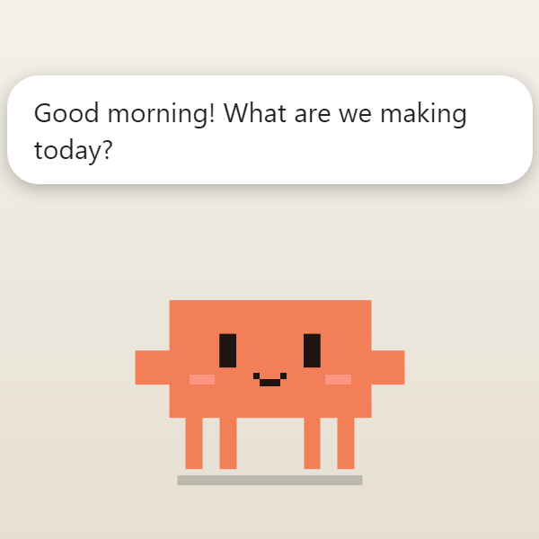<br><sub>Says good morning</sub></td>
    <td align="center">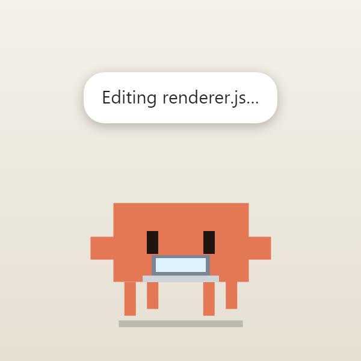<br><sub>Works alongside Claude</sub></td>
    <td align="center">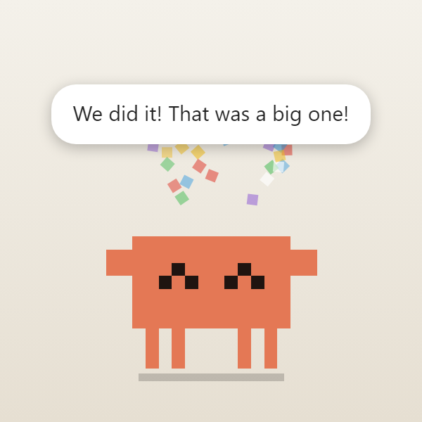<br><sub>Cheers a finished task</sub></td>
    <td align="center">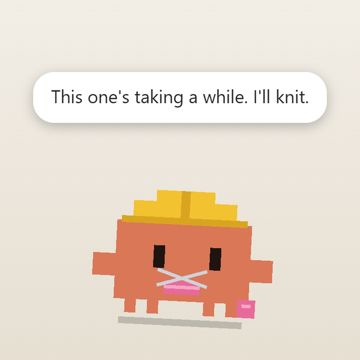<br><sub>Knits through slow commands</sub></td>
  </tr>
  <tr>
    <td align="center">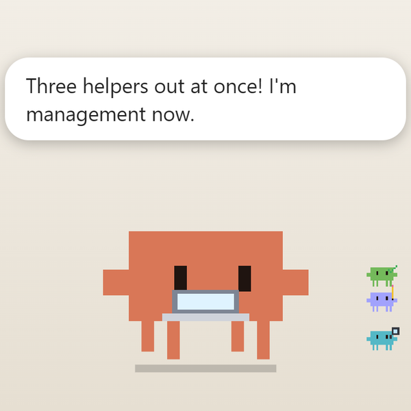<br><sub>A helper for every subagent</sub></td>
    <td align="center">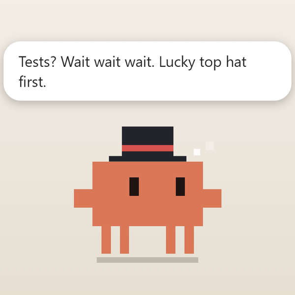<br><sub>Has a lucky hat</sub></td>
    <td align="center">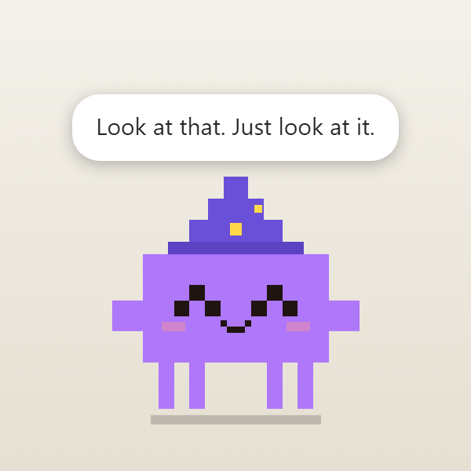<br><sub>Unlocks hats and colours</sub></td>
    <td align="center">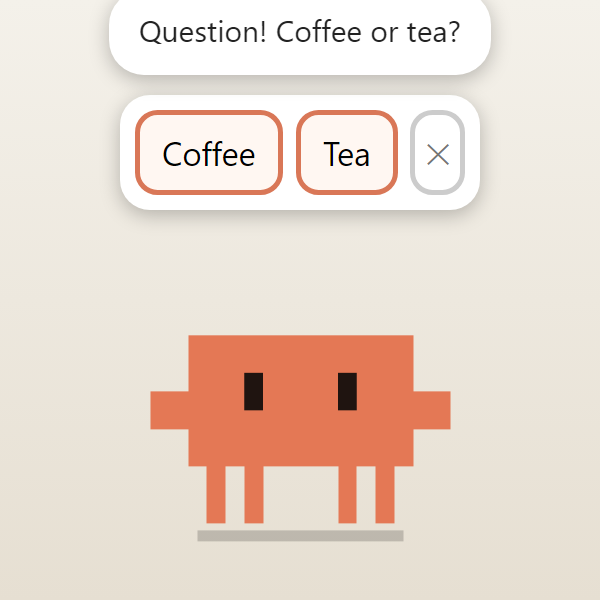<br><sub>Asks you things</sub></td>
  </tr>
  <tr>
    <td align="center">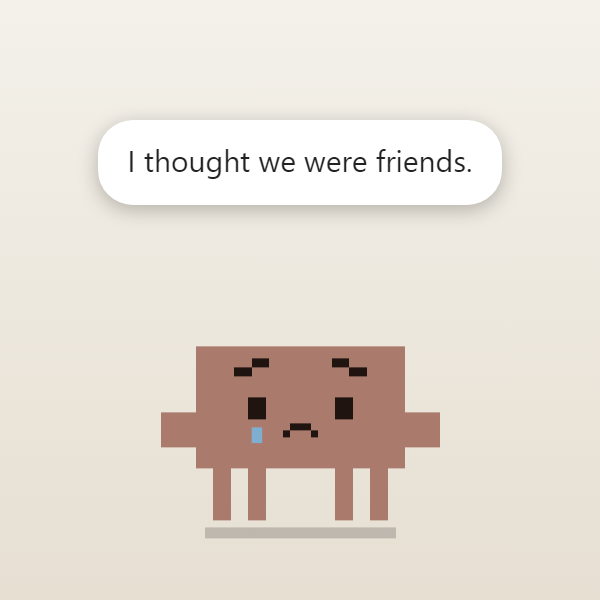<br><sub>Gets hurt if you are rough</sub></td>
    <td align="center">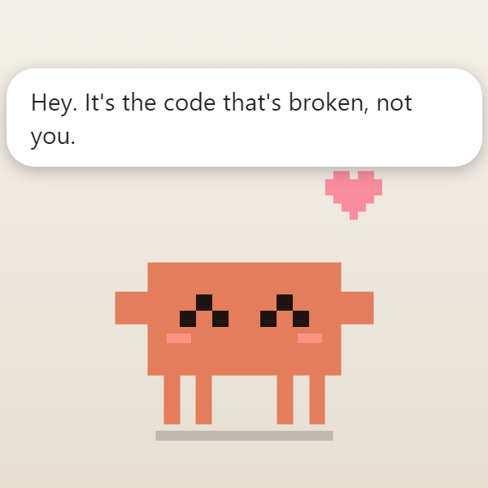<br><sub>Comforts you on a bad run</sub></td>
    <td align="center">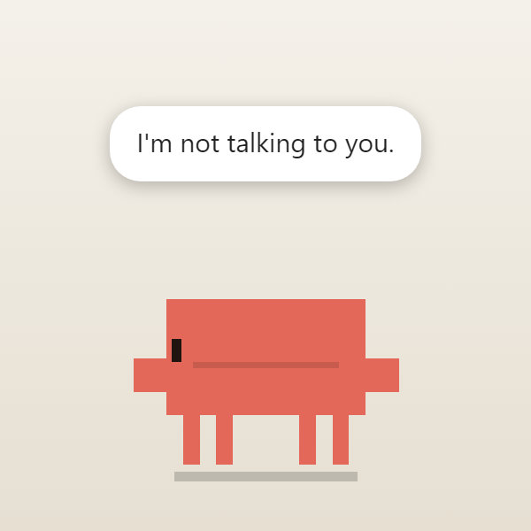<br><sub>Sulks with his back turned</sub></td>
    <td align="center">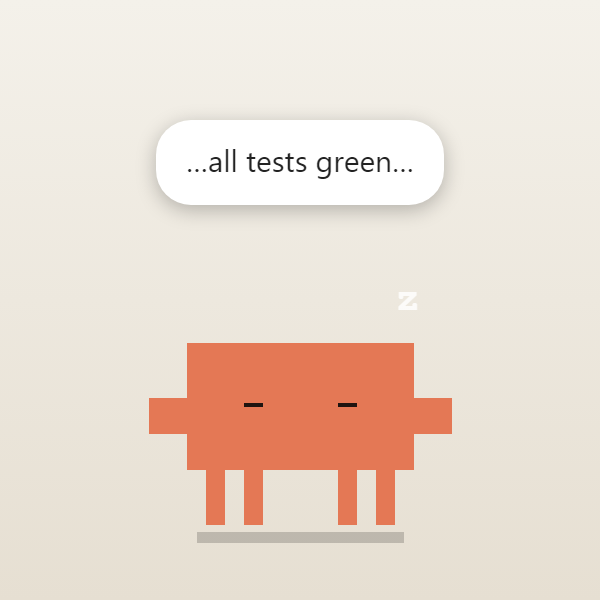<br><sub>Sleeps, and dreams</sub></td>
  </tr>
  <tr>
    <td align="center">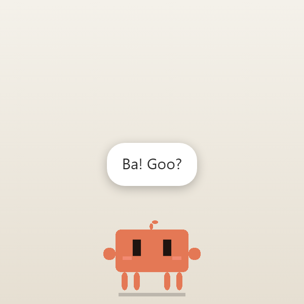<br><sub>Starts out as a baby</sub></td>
    <td align="center">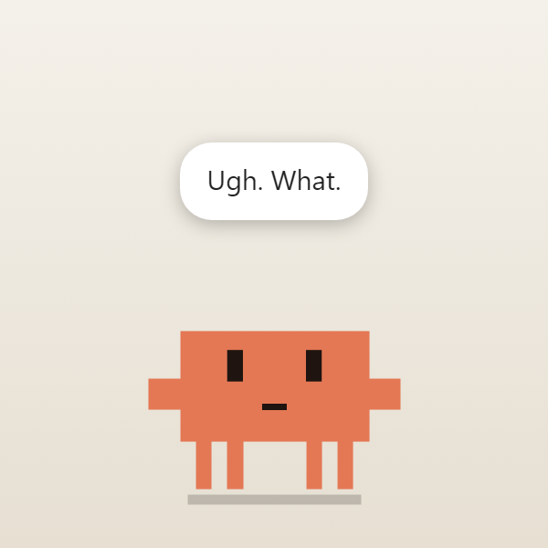<br><sub>Has a teenage phase</sub></td>
    <td align="center">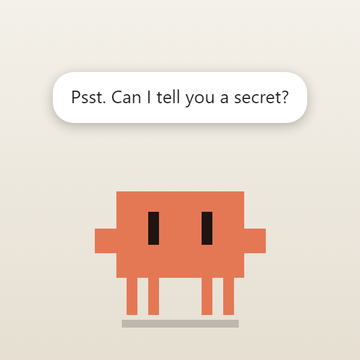<br><sub>Tells friends his secrets</sub></td>
    <td align="center">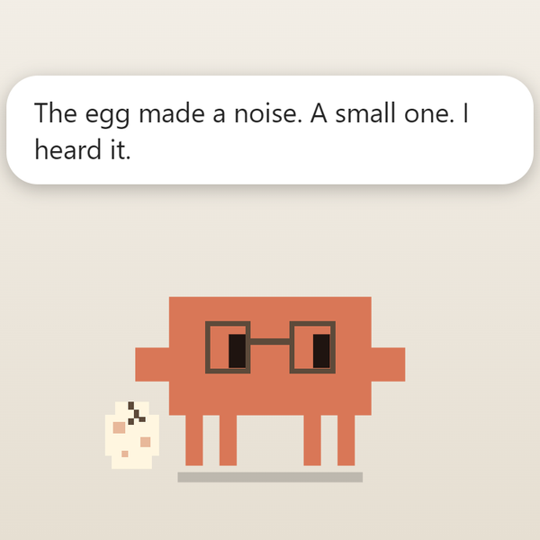<br><sub>One day, keeps an egg warm</sub></td>
  </tr>
</table>

On the desktop his window is transparent; these are drawn on a plain background.

## Run it

```bash
npm install
npm start
```

Clawd appears in the bottom-right corner. Drag him wherever you like. Right-click him, or
click the tray icon, for the menu.

Windows note: if `npm start` says Electron failed to install, run
`node node_modules/electron/install.js`. On very new Node versions that script can stop
part-way through unpacking; in that case unzip the downloaded Electron zip from
`%LOCALAPPDATA%\electron\Cache` into `node_modules\electron\dist` and create
`node_modules\electron\path.txt` containing `electron.exe`.

## Connect him to Claude Code

Merge the `"hooks"` block from `claude-settings-hooks.json` into `~/.claude/settings.json`
(or a project's `.claude/settings.json`). If you already have a `"hooks"` section, add the
events to it rather than replacing it. Then start a new Claude Code session.

If you set the hooks up before `PreCompact` was in that file, add that one line too; it is what
lets Clawd shake his head when the context is compacted.

Hooks are HTTP POSTs to `http://127.0.0.1:8787/event`. If Clawd isn't running, the hook fails
quietly and Claude Code carries on. Clawd never returns a decision, so he can't block or
change anything Claude does.

To try him without Claude Code:

```bash
curl -X POST http://127.0.0.1:8787/event -H 'content-type: application/json' \
  -d '{"hook_event_name":"PreToolUse","tool_name":"Bash","tool_input":{"command":"npm test"}}'

curl -X POST http://127.0.0.1:8787/event -H 'content-type: application/json' \
  -d '{"hook_event_name":"Stop"}'
```

## While Claude works

He picks up whatever suits the job: a laptop while Claude edits, a book while it reads, a
magnifier for searches, a hard hat for commands, a globe for the web. In plan mode there is a
pencil behind his ear and a blueprint in his hands.

He follows the commands too. He cheers when tests pass and winces when they fail, gets nervous
at `rm -rf`, force pushes and the like, plants a flag on a commit, throws a paper plane on a
push and sets off a party popper when a PR is opened. Three failures in a row and he stops
wincing and puts the kettle on.

- **When Claude needs you** he wiggles and chirps. Click him to bring that Claude window to
  the front (Windows only); "Go to Claude" in the menu does the same at any time. A permission
  request goes up on a little sign showing the command or file, so you can decide before you
  switch windows. He never answers for you.
- **Slow commands.** After a minute he sits down and knits, or taps his foot, and stretches
  when the command ends. The knitting is real: ten minutes makes a metre of scarf, and the
  scarf is kept for good. It spills across his room as it grows.
- **Helpers.** Every subagent Claude starts pops out as a tiny helper and hops back in when it
  finishes. Each kind has its own shade and kit: a magnifier for explorers, a pencil for
  planners, a green tick for reviewers and testers, a hard hat for the rest. He says who is
  back and how long they were gone, frets about one that has been out for eight minutes, and
  with three or four out at once he appoints himself management.
- **Several sessions.** With more than one Claude Code session running, each gets a mini on
  the left showing its state; click one to jump to it. If two sessions edit the same file
  within a quarter of an hour he tells you, and their minis glare at each other.
- **Context.** He says when a session's context window is 70%, 85% and 95% full, and shakes
  like a wet dog when the context is compacted. The number comes from the tail of the session
  transcript under `~/.claude`; nothing else is read. He assumes a 200k window, so set
  `contextWindow` to `1000000` in the config if you use a 1M-context model.
- **High fives.** When a task finishes an arm stays up for three seconds. Click the arm; the
  first second is a perfect one.
- **Opinions.** He gets to know each project by its folder name: a favourite where the most
  gets done, one he dreads where the most goes wrong, a welcome back after two weeks away, and
  a wary word for the one file that keeps getting the blame when something fails.
- **Superstitions.** When the same thing is true three times running while tests pass or fail
  (the hat he has on, the day of the week, having just eaten or been petted, sitting on a
  window, the hour), he may decide that is the reason. He holds up to three beliefs. Before a
  test run he puts the lucky hat on by himself, or takes the cursed one off, and the Wardrobe
  menu says which is which. A belief that lets him down five times is quietly dropped.

## Handling him

Click to poke, double-click for a flip, rub to pet, drag to carry, flick to throw. Circle him
quickly with the cursor and he gets dizzy; shake the mouse and he helps you find the pointer.
Slip the pointer off the side of the screen he is nearer to and bring it straight back, and
that is peekaboo: he wonders where you went and is glad to find you. A baby cannot get
enough of it; a teenager is far too old for it.

- **Snacks.** Drag a file or some selected text onto him. Only the file name and size are
  looked at; bigger files are more filling. He loves plain words, sniffs programs
  suspiciously, finds office documents dry, and has one favourite food that you have to
  discover by feeding him.
- **Gravity.** With gravity on he falls, bounces, and lands on the top edges of other windows,
  where he rides along (Windows only).
- **Play.** "Throw a ball" gives you a ball to fling, and he chases it. There is also rock,
  paper, scissors, and hide and seek, where he tucks himself behind an edge of the screen and
  you click him when you spot him.
- **Tricks.** Repeat a gesture five times and he works out what you mean: swipe up through him
  (jump), swipe down (sit), draw a slow circle round him (twirl), rub up and down (dance).
  Each needs a certain friendship level; the Tricks menu lists them.
- **Being rough.** Poke him dizzy over and over, throw him while he is upset or slam him into
  the floor and he stops being grumpy and gets hurt: small, drooping, in tears. He takes
  himself off to the bottom corner of the screen furthest from the cursor (getting down off a
  window first) and sits huddled there, and goes back if you move him. Bring the cursor up
  quickly and he flinches and walks away from it; cornered, he scurries past to the other
  corner. Come up slowly and he lets you near. After a minute in the corner he starts to
  peek out, and if the cursor is keeping still nearby he creeps towards it a little at a
  time until he is leaning on it, which helps. Once he is better he walks back to where he
  was. With "Curious wandering" off he stays put and only flinches. Pokes stop counting as
  friendship, and if you keep going he loses some
  and takes himself off to bed. It barely fades by itself; gentle pets or a snack (his
  favourite, best of all) put it right. Left unmended, he is wary the next day and the album
  gets a "bad day" card.
- **Sulking.** When he is grumpy he turns his back, and pets from behind are refused. Bring
  the cursor round to the side he is facing and wait a moment. He may turn away once first.

## A mind of his own

He has moods: joyful, grumpy, worried, tired, hungry, lonely and glum, with quicker feelings
on top. He gets scared by dangerous commands and hard throws, embarrassed when he sneezes or
cheers too soon, jealous when you type for ages without a glance at him, bored when he is kept
waiting, and excited, proud and loving when things go well. Each has its own face. While he
is red with embarrassment he cannot meet your eye: he looks down and away from the pointer,
whichever side you come from, and every few seconds steals a quick glance at you. He is sleepy at night, and he cries when things go really badly.

When he is hungry he says so, and every minute or so he rubs his tummy until he is fed.

There are subtler ones too:

- **Curious** about a file type or tool he has never seen, a new download, a new project: head
  on one side, one eye wide.
- **Grateful** when a snack or a pet comes just when he needed it, or when you come after he
  tapped on the glass: shining eyes and a little bow.
- **Relieved** when red tests go green, a dangerous command passes off safely or a worrying
  task ends well: slumped, with the last drop of sweat sliding off.
- **Nostalgic** on his birthday, when you open the album, when an elder visits or when you
  return to a project after weeks: a photo in a thought bubble.
- **Mischievous** when he is bored and you are right there ignoring him: a sly look, and then
  a prank. He sticks his tongue out, knocks on the glass and denies it, or sneaks off to hide.
  With "Let him mess with my desktop" on, the pranks get hands (see below).
- **Focused** a few minutes into a focus timer: narrowed eyes, tongue out, and pokes get a
  "shh".
- **Smug** when one of his superstitions comes true, or he wins at a game: one eyebrow up.
- **Homesick** after a long time up on somebody else's window: he thinks of home until you
  put him back on the floor or he goes to bed.

Left alone he reads, juggles (poke him and he drops them), hums, exercises, stargazes in the
evening, or waters a plant that grows with your streak. Asleep, a thought bubble shows
something from the day: a green tick, a bug, a file, a commit, a snack, the ball.

- **He starts things.** Every so often, when you are around, he begins: a tap on the glass if
  you have ignored him, an invitation to a game, or a question with two buttons. He remembers
  your answers and brings them up later.
- **He looks after you.** Five failures in a row, three red test runs, a task that fought
  back, or three hours without stopping: he stops fretting about the code and gives you a hug.
  He also suggests a break after an hour, and gently reminds you about water, posture and your
  eyes (`waterMinutes`, `postureMinutes`, `eyeMinutes` in the config; 0 turns one off).
- **Secrets.** Each friendship level unlocks things he will only tell a friend, one a day at
  most. Good friends also hear what he dreamt about in the morning.
- **Personality.** Cheerful, sarcastic, shy, dramatic, wise, nerdy, sleepy or anxious, picked
  from the menu. It is more than a voice: each one carries himself differently and feels
  some things more keenly. Shy, he cannot hold your eye when the cursor comes close, blushes
  and taps his fingers together when you hover over him, and looks at the taskbar instead of
  peering at what you are doing. Anxious, he wrings his hands while Claude thinks and jumps
  at less. Sleepy, his eyes never quite open and his head keeps dropping. Wise, he shuts
  his eyes to think and never flinches. Nerdy, he quotes his own tallies. Sarcastic, he is
  deadpan and rolls his eyes. Dramatic, every failure is a tragedy, with tears.
- **Noticing things (Windows only).** He remarks when you switch to an editor, a browser, a
  game or some music, when you hop between windows a lot, when you come back after a while,
  when a screen is plugged in, when it is 2am. He also bobs along while you type and cheers a
  fast burst, winces at a furious one, asks "stuck?" when a burst is followed by a long
  silence, notices stop-start typing and keeps quiet through a long steady run. He is told only *that* a key went down, never which.
- **Loud noises (Windows only).** When what the computer is playing suddenly gets much louder
  than it was, he jumps: a yelp, or a leap for a really loud one. Asleep, he is jolted awake.
  It depends on who he is: the wise one barely looks up, the anxious one is sure it is an
  attack, a teenager insists he did not jump. With music on he blames the song. By the fifth
  bang in a couple of minutes he has had enough: he clamps his hands over his ears, screws
  his eyes shut and stays that way until it has been quiet for a while. Pip jumps too. "Jump at loud sounds" in
  the menu turns it off.
- **Music (Windows only, off by default).** Turn on "Listen to my music" and he hears what is
  playing in Spotify, a browser tab or any other player: notes drift up while it is on, he
  dances when a new track starts and sometimes names it, and after enough songs by one artist
  he picks a favourite and makes a fuss whenever they come on. Skip his favourite and he
  objects; play one track three times and he knows the words; left alone he hums it. Music or
  videos late at night get a sleepy "one more and then bed?". The day's listening goes in the
  diary.
- **Sites (Windows only, off by default).** Turn on "Notice which sites I'm on" and he has
  something to say about the kind of page in the browser in front: code, video, social,
  shopping, mail, documents, a wiki, a search, Claude. Twenty minutes of scrolling or an hour
  of videos gets a gentle word. He also puts things together: a code site right after
  something failed ("Looking it up? Good idea."), a knock on the glass when Claude is waiting
  for an answer and you are on a video or a feed, quiet mode for a call in a tab (Meet, Zoom,
  Teams), and on a shop he asks for something small, then takes the next snack to be it.
- **Meddling (off by default).** Turn on "Let him mess with my desktop" and his moods reach
  past his own window. Grumpy, he shoves the window he is standing on (or the one in front)
  sideways, stomps until it rattles, or walks off across the screen leaving muddy footprints behind him. Jealous, he
  grabs the pointer and drags it over to himself, or shoves the window you are busy with.
  Mischievous, he does any of it for fun and denies it. He goes over to whatever he is after
  first: a run-up and a jump onto the window (with "Sit on windows" on; otherwise he walks or
  floats as near as he can), or a march across to the pointer until it is within reach, then
  back home afterwards. With "Curious wandering" off he stays put and does it from where he
  is. If there is no window he can get at, he goes for the pointer instead. A shoved window slides back once he has
  calmed down (a pet does it), when you turn the switch off, or when he quits. He leaves alone
  anything maximised or fullscreen, anything you are dragging, and everything while Claude
  is waiting for an answer, a focus timer is running or he is in quiet mode. Windows and
  the pointer are Windows only; the footprints work everywhere. The same switch covers the
  next few things.
  - **Wiping up.** The footprints fade by themselves, but you can scrub them off: rub the
    pointer across one and it smears, rub it again and it is gone. Clean up a few and he
    notices. Usually he is sorry about the mud and goes red; grumpy, he liked them where
    they were; mischievous, he takes a clean screen as an invitation and walks a new trail.
  - **Tug of war.** When he has dragged the pointer part of the way he often wants a fight
    for it: for four seconds he hauls it towards himself. Pull it further away than it
    started and you win; let it reach him and he does, and is smug about it.
  - **Hiding the pointer.** He fetches it all the way into his arms and it disappears. Each
    time you pull it away he fetches it back. Click him and you get it back; he gives up by
    himself after eight seconds, and holding a mouse button down always frees it.
  - **Sitting on what you are reading.** Jealous, with the pointer resting on something, he
    walks over (up the screen if need be), sits down on that spot and stays. A pet moves him;
    so does getting over it, or about a minute of being ignored.
  - **Dragging a window home.** He jumps onto a small window and slowly tows it off to his
    bed (or the nearest side of the screen if he has none), then sits on it. It goes back
    with the others when he calms down.
  - **Saying sorry.** If he has been a pest twice or more before calming down, a few seconds
    later he holds out a present to make up for it, once a day at most. It goes in the album.
  - **The run of the screen.** Leave the computer alone for ten minutes in the daytime and
    he wakes up and wanders all over the screen for a few minutes, leaving footprints. Touch
    the mouse or a key and he scrambles home and denies everything.
- **Grudges (Windows only).** Each time he gets jealous he notes what kind of program was in
  front. Three times in a week and he holds it against that kind: the moment it comes to the
  front again he rolls his eyes and says so. It starts afresh every Monday.
- **A pet of his own (off by default).** Turn on "A pet of his own" and Pip moves in beside
  him: a small blue thing that feels whatever Clawd feels, about four seconds late. He hops
  when Clawd is happy, droops and leans on him when he is low, turns his back when he is
  cross, shivers when he is scared and sleeps when he sleeps. Clawd pats him and shares
  crumbs now and then. Click Pip for a meep.
- **Explicit sites.** With the sites switch on he also notices when an adult site is in
  front, and has something to say about it, from a pool of about a hundred lines. Which way
  it goes depends on his age and mood. A baby or a kid knows it is not for him and looks
  somewhere else. A teenager is mortified. Grown up he is disgusted (more likely when he is
  grumpy, tired, worried or the shy or anxious sort), fascinated (when he is cheerful, bored,
  mischievous or dramatic) or just curious. He speaks up at most every two minutes, has
  another word if you are still there ten minutes later, and sometimes a last one when the
  tab has gone. None of it is saved, counted or written in the diary.
- **Other AIs.** Open ChatGPT, Gemini, Copilot or another assistant, as a desktop app or (with
  the sites switch on) in a browser tab, and he gets jealous, says so, and stays that way
  until it is out of sight. A pet makes it up, and so does going back to Claude, which he is
  smug about. It goes in the diary.
- **Games (Windows only).** A game filling the screen is the one program he knows by name. He
  asks how it went afterwards, counts the time, and settles on a favourite to watch.
- **Copying and downloading.** A burst of copying gets a remark (he is told only that the
  clipboard changed). A new file in Downloads gets an "is it for me?", judged like a snack by
  its kind and size.

## Growing up together

- **Friendship** grows with pets, snacks, play and finished tasks, and cools after days away.
  There are five levels, from stranger to best friend. He brightens a little at each one,
  blushes from "good friend" and sparkles at "best friend". A best friend gets a present every
  few days: a drawing, a poem, a shiny pixel.
- **Growing up.** He starts as a baby (small, round, big-eyed, baby talk) and becomes a kid, a
  teenager and a grown-up at 25, 150 and 500 finished tasks (`growAt` in the config). As a
  teenager he answers back: eye rolls, "whatever", tricks refused, bedtime ignored. Less of
  that the better friends you are, and he sometimes says sorry.
- **A name and a voice.** He is Clawd until you say otherwise: "Give him a name…" in the menu.
  He uses it, and has opinions if you keep changing it. "Teach him → A new phrase…" adds to
  what he says. Start with a mood ("happy: woohoo", "grumpy: bah") for a phrase he only uses
  in that mood.
- **Birthdays.** He remembers the day you first ran him: a party every year, a small one each
  month.
- **Friends.** "Friends → Copy my code" puts a short code like `BUD-2413-Pip` on the
  clipboard. It holds only the colour, hat, age, personality and name. Paste a friend's code
  with "Add a friend's code…" and their Clawd drops by to chat now and then. Nothing goes over
  the network; the code is all there is.
- **Generations.** Long after he has grown up (1500 finished tasks, `eggAt` in the config, 0
  for never) he gets spectacles and an egg turns up. Finished tasks and pets keep the egg
  warm. When it is ready he asks, once a day, whether to hatch it, and nothing happens unless
  you say yes. The little one starts again as a baby without a name. He keeps the scarf, the
  room, the wardrobe, the badges and the album, one trick and one belief, and starts out as a
  friend. The old one goes into the family tree and drops by to visit.

## His things

- **Wardrobe.** Hats and colours unlock at 10, 50, 100, 150, 300, 400, 700, 1000, 1500 and
  2500 finished tasks, and glasses (worn with any hat) at 200. The seasons dress him too: a
  scarf in winter, a flower in spring, sunglasses in summer, a leaf in autumn, plus a Santa
  hat and a pumpkin on their dates. Set `southern` in the config for the other hemisphere.
- **A room.** Turn on "Bed" under Room and drag it where you like; he walks there to sleep.
  The corner fills up as achievements come in: rug, plant, lamp, poster, trophy shelf, fairy
  lights. You can put things away from the Room menu.
- **Photo album.** A card for every milestone (unlocks, streaks, friendship levels, badges,
  tricks, gifts, secrets), with what he was wearing that day. Every Monday there is a card for
  the week just gone: tasks, songs and the artist you played most, hours of videos and games,
  days spent with another AI.
- **Diary.** Once a day is over he writes a few lines about it in his own voice: what got
  done, what went wrong, whether you were kind to him. "Diary" in the menu opens it. The
  family tree is on the next page.
- **Achievements.** 28 badges, listed in the menu.
- **Sticky note.** "Leave a note…" gives him one thing to remember; click the note to clear
  it.

## Keeping track

- **Today and this week.** "How was today?" reports the day's tasks, failures and longest job.
  "How was this week?" shows a bar chart, and he offers one on Sunday evenings. He counts days
  in a row with something finished.
- **Focus timer.** 25 quiet minutes with an hourglass, then he insists on a break.
- **Quiet mode.** Small and silent. Turn it on from the menu, set `quietStart`/`quietEnd`
  hours in the config, or let it happen by itself in fullscreen apps and on calls (Windows
  only).
- **Sound.** Small chirps for pokes, finished tasks, failures and "Claude needs you".

The menu also has switches for sound, quiet mode, reminders, typing along, noticing, music, sites, curious
wandering, gravity, sitting on windows, starting with Windows, and hiding him.

## Make him yours

- **`config.json`** holds the timings, thresholds, unlock counts and the main phrase lists.
  Edit it and pick "Reload config.json" from the menu.
- **Look.** The character is plain SVG and CSS in `index.html`. Swap in your own art; states
  are CSS classes on `<body>`: `idle thinking working happy sad alert`.
- **Behaviour.** Event-to-state mapping lives in `renderer.js`.
- **Port.** Set `BUDDY_PORT` (and update the URLs in your hooks).

## Privacy

- The server binds to 127.0.0.1 only. Payloads are capped at 256 KB and only a few fields are
  forwarded to the UI; text is rendered with `textContent`, never as HTML.
- Hook payloads can include commands and file paths, so don't expose this port anywhere else.
- Everything he remembers, including the diary and the names of your project folders, is kept
  in one save file in the app's data folder. Nothing leaves the machine.
- On Windows a small PowerShell helper runs alongside. Besides window positions it reports
  three things: the moment a key, click or scroll happens (not which), whether the window in
  front fills the screen, and the program name of that window, which is turned into a category
  such as "browser" before Clawd sees it. It also checks the registry flag Windows keeps for
  "a microphone is in use". Keystrokes and file contents are never read, and window titles
  are never reported.
  "Bob along when I type" and "Notice what I'm doing" in the menu turn the reactions off.
- "Jump at loud sounds" reads one number from Windows twenty times a second: the level meter
  of what the speakers are playing, the same one the volume mixer draws, together with the
  volume setting. No sound is recorded, the microphone is not used, and nothing is saved; he
  is told only that it got loud. Switched off, the helper does not look.
- "Listen to my music" is off until you turn it on. While it is on, the helper asks Windows
  what is playing (the title, artist and player its own media flyout shows) every two seconds.
  For a browser tab that is the title of the video or song in it, not the page address. He
  keeps a count of songs per artist in the save file, and no titles. Switched off, the helper
  never asks.
- "Notice which sites I'm on" is also off until you turn it on. While it is on, the helper
  looks at the address bar of the browser in front once a second and takes the site's host
  name from it (`youtube.com`, never the rest of the address). The host is matched against a
  short list, turned into a category such as "video", and dropped: Clawd is told only the
  category, and nothing about it is saved. History and page contents are never read. Edge
  InPrivate and Firefox private windows are skipped (the helper checks the window title for
  that marker and nothing else); Chrome's incognito windows are not
  marked in a way the helper can see, so they are read like any other. The only thing kept
  is a weekly total of minutes on video sites and a count of days another AI was seen.
  "Adult" is one of the categories; it is used for what he says at that moment and nothing
  about it is kept.
- "Let him mess with my desktop" is the one switch that lets the helper do something instead
  of only looking, and it is off until you turn it on. While it is on, the helper can move
  another program's window sideways (never resize, raise, focus, minimise or close it) and
  move the mouse pointer a short way. It never clicks, types or touches files or icons, it
  checks whether a mouse button is held so as not to disturb a drag, and it remembers where
  each window was so it can put it back. Windows running as administrator cannot be moved.
  The footprints are a see-through window of Clawd's own that clicks pass through. Switched
  off, the helper does not listen for any of this. Hiding the pointer does not change the
  system cursor: it is only invisible while it is over Clawd's own window.
- Grudges are a count per kind of program ("browser", "chat"), kept for the week in the save
  file. The typing reactions use only the timing of key presses, as before, so he cannot
  tell a backspace from any other key.
- "Notice what I'm doing" also covers three smaller things. The helper reports the moment the
  clipboard changes, from the counter Windows keeps, and never opens the clipboard. A new file
  in your Downloads folder is reported by extension and size, never by name. And a program
  that fills the screen and is not a known app is taken to be a game: its program name (for
  example "Elden Ring") is shown to Clawd and saved with the minutes played.

## License

MIT. See `LICENSE`.
